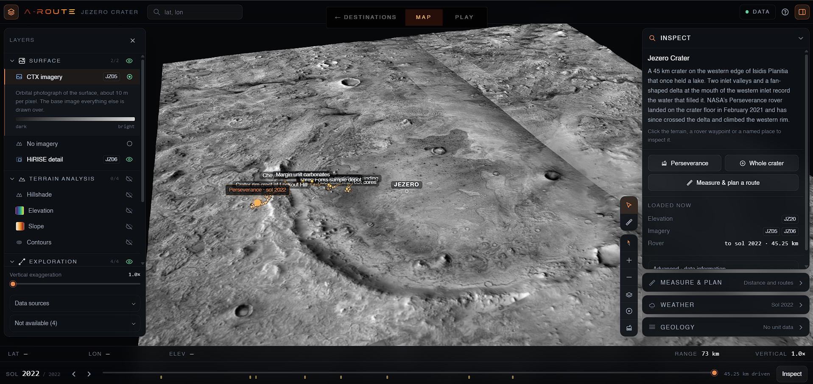
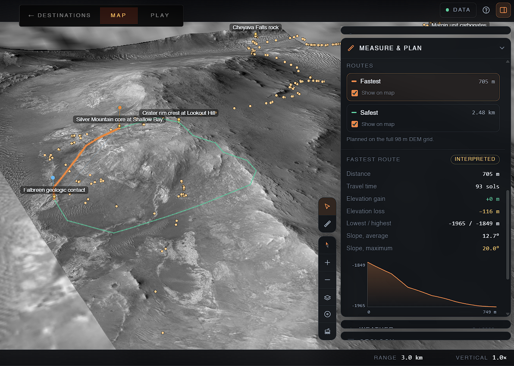

<div align="center">


[](https://nextjs.org/)
[](https://react.dev/)
[](https://developer.mozilla.org/en-US/docs/Web/JavaScript)
[](https://threejs.org/)
[](https://r3f.docs.pmnd.rs/)
[](https://tailwindcss.com/)
[](https://www.nasa.gov/)
[](https://science.nasa.gov/mars/)

<br>

[](https://www.spaceappschallenge.org/)

</div>


A-ROUTE is an interactive Mars mapping and exploration application developed for the **NASA Space Apps Challenge 2026 – Interplanetary Survival Guide: Martian Map**. It brings terrain data, rover records, and selected science observations into one spatial interface for **Gale Crater (Curiosity)** and **Jezero Crater (Perseverance)**.


## Features and data use

### 3D terrain map
- **Mars Trek imagery tiles** provide the map's orbital surface imagery and supported imagery layers.
- **Crater DEM/DTM data** is processed into height grids and terrain assets. These elevation measurements drive the 3D surface—not the imagery texture.
- The same terrain grid is sampled to derive **elevation, slope/steepness, contours, and elevation profiles**.
- Imagery and elevation are separate layers, so the visual surface can be viewed alongside terrain analysis.



### Terrain inspection and route planning
- Select a terrain point to inspect its coordinates, elevation, and derived terrain information.
- **Fastest** and **Safest** routes are calculated over the available elevation grid using terrain-aware path costs.
- Route results depend on editable assumptions such as slope limits and route-cost settings. They are estimates for exploration, not validated rover commands or predictions of actual mission travel time.



### Rover data and exploration
- Curiosity and Perseverance traverse/waypoint records are displayed as rover paths and locations where data is available.
- Rover panorama images are associated with their recorded locations, allowing users to view surface imagery in context.
- Curiosity drill/sample locations and selected science records are used as spatial exploration points and mission activities. Mission content links a location to its image and scientific context; it does not represent a new analysis of the sample.


### Weather
- **REMS** observations support Curiosity/Gale weather information.
- **MEDA** observations support Perseverance/Jezero weather information.
- Weather values are instrument observations tied to rover location and mission time, not crater-wide measurements or forecasts.

## Architecture

Built with **Next.js, React, Three.js / React Three Fiber, and Zustand**.

- **Shared map engine, crater-specific configuration:** Gale and Jezero use common map, terrain, camera, interaction, and analysis components. Crater configuration supplies geographic bounds, terrain assets, layers, rover data, and location registries.
- **Preprocessed terrain:** DEM/DTM files are converted into browser-readable height grids and terrain assets before runtime. The browser renders and samples these prepared data rather than processing source rasters from scratch.
- **Separate geometry and texture:** elevation grids define terrain shape; imagery supplies surface appearance. Derived analysis uses the elevation grid.
- **Data adapters:** traverse, weather, imagery, and science records are normalized separately from UI components.
- **Separate MAP and PLAY experiences:** MAP supports layer-based inspection and terrain analysis; PLAY provides first-person, mission-based exploration using crater terrain and selected rover/science locations.
- **Editable route assumptions:** route costs and constraints are parameters, making the basis of fastest/safest estimates inspectable and adjustable.

## Data sources

Source references and dataset notes are maintained in [`data/sources.json`](data/sources.json) and [`docs/`](docs/).

- [NASA Mars Trek](https://trek.nasa.gov/mars/) — orbital imagery and map layers
- [Geologic Map of Mars](https://pds-atmospheres.nmsu.edu/data_and_services/atmospheres_data/PERSEVERANCE/meda.html) — planetary elevation and topographic products
- [Mars Weather data](https://pds-atmospheres.nmsu.edu/data_and_services/atmospheres_data/PERSEVERANCE/meda.html) - weather observations
- [Perseverance panorama images](https://mastcamz.asu.edu/mars-images/panoramas-mosaics/?item_type=360-panoramas&pg=1) — Perseverance panorama and rover imagery
- [Curiosity panorama images](https://mars.nasa.gov/msl/multimedia/raw-images/?order=sol+desc%2Cinstrument_sort+asc%2Csample_type_sort+asc%2C+date_taken+desc&per_page=50&page=0&mission=msl) — Curiosity panorama and rover imagery
- [Gale Crater Stereo CTX DTM](https://figshare.com/articles/dataset/Gale_Crater_Stereo_CTX_DTMs_Orthoimages/6584984?file=12096848) — 1 m/pixel DEM combining HRSC, CTX and HiRISE data
- [Jezero Crater Stereo CTX DTM](https://astrogeology.usgs.gov/search/map/mars_2020_science_investigation_ctx_dem_mosaic?utm_source=chatgpt.com) - 20 m/pixel CTX stereo DEM
- [Curiosity’s 42 Drill Holes](https://astrogeology.usgs.gov/search/map/mars_2020_science_investigation_ctx_dem_mosaic?utm_source=chatgpt.com) - Locations where curiosity drilled for experimentation
- NASA/PDS rover traverse and science records — rover paths, locations, and selected observations

Some source data is downloaded and preprocessed into local assets; the application does not stream every dataset live.

## Run locally

```bash
npm install
npm run dev
```

Open http://localhost:3000. Terrain preparation scripts and their input requirements are in [`scripts/`](scripts/).

## Scope and limitations

Terrain layers and derived values depend on source resolution, coverage, and preprocessing. Route outputs use simplified terrain costs and do not model all rover engineering, soil, obstacle, or operational constraints. Weather and science records retain their source location/time context.

## Acknowledgements

A-ROUTE uses planetary data and research from NASA mission teams, USGS Astrogeology, and the planetary-science community. Refer to the source registry and original dataset credits when reusing data.
